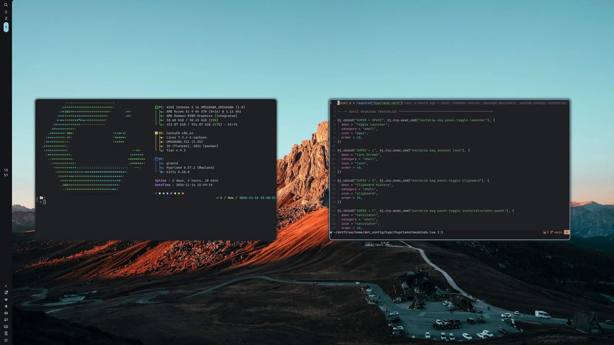

<p align="center">
  
</p>

<p align="center"><sub>CachyOS · Hyprland + KDE · Noctalia · ASUS Zenbook S16</sub></p>

# dotfiles

My CachyOS setup: Hyprland + KDE, fish, kitty, and the small system tweaks that
make the machine feel like one piece. Dotfiles are managed with **chezmoi**;
packages, `/etc` files and services live next to them, so a fresh install is a
single command.

## Quick start

```bash
git clone https://github.com/C010UR/linux-dotfiles.git ~/dotfiles
cd ~/dotfiles
./bootstrap.sh
```

The script shows what it detected, lets you toggle the optional pieces, then
installs packages, copies system files, enables services and applies the
dotfiles. Nothing is written before you continue.

```bash
./bootstrap.sh --dry-run   # print the plan, change nothing
./bootstrap.sh --yes       # accept the defaults, no prompts
./bootstrap.sh --no-nvim   # skip a component (system, flatpak, nvim, device)
```

## What's inside

- `home/` — chezmoi source for `$HOME`: Hyprland, Noctalia, fish, kitty, btop…
- `system/` — the portable `/etc` files and units for the base system
- `packages/` — explicit native, AUR and Flatpak apps, no dependency clutter
- `devices/` — hardware-specific extras, applied only when the DMI matches
- `components/` — optional things that live in their own repositories

## Optional components

| Piece | What it does |
|---|---|
| **Neovim** | Clones [neovim-setup](https://github.com/C010UR/neovim-setup) into `~/.config/nvim`. It stays a separate repo; bootstrap only clones or fast-forwards it, and never touches a dirty checkout. |
| **ASUS Zenbook S16** | `asusctl`, the touchpad daemon, power-button stack, and limine + snapper. Offered only when the hardware matches. |
| **Flatpaks** | Flatseal, OrcaSlicer and LibreOffice. |
| **System files** | Copies `system/` into `/etc` and enables the units in `units/`. Skippable if you only want the desktop config. |

## Everyday use

```bash
chezmoi add ~/.config/something   # start tracking a file
chezmoi edit ~/.config/hypr/...   # edit the source
chezmoi diff && chezmoi apply     # preview and apply
./scripts/export-packages.py      # refresh the package lists
```

The package lists only contain explicit packages — dependencies come in on their
own. `packages/excluded.txt` records the libraries that were deliberately left
out.

## Not in git

Wi-Fi and VPN credentials, SSH/GPG keys, tokens, browser profiles and
`fish_variables` stay out of the repo on purpose. The manual steps are printed
when bootstrap finishes.

## Notes

- Written for CachyOS (Arch-based); the base manifests use its repos.
- The base setup is bootloader-agnostic. limine + snapper live in the ASUS device
  profile, so a VM or another laptop gets a clean install.
- `home/` maps one-to-one to `$HOME`, so it can move to Home Manager later
  without changing the layout.
